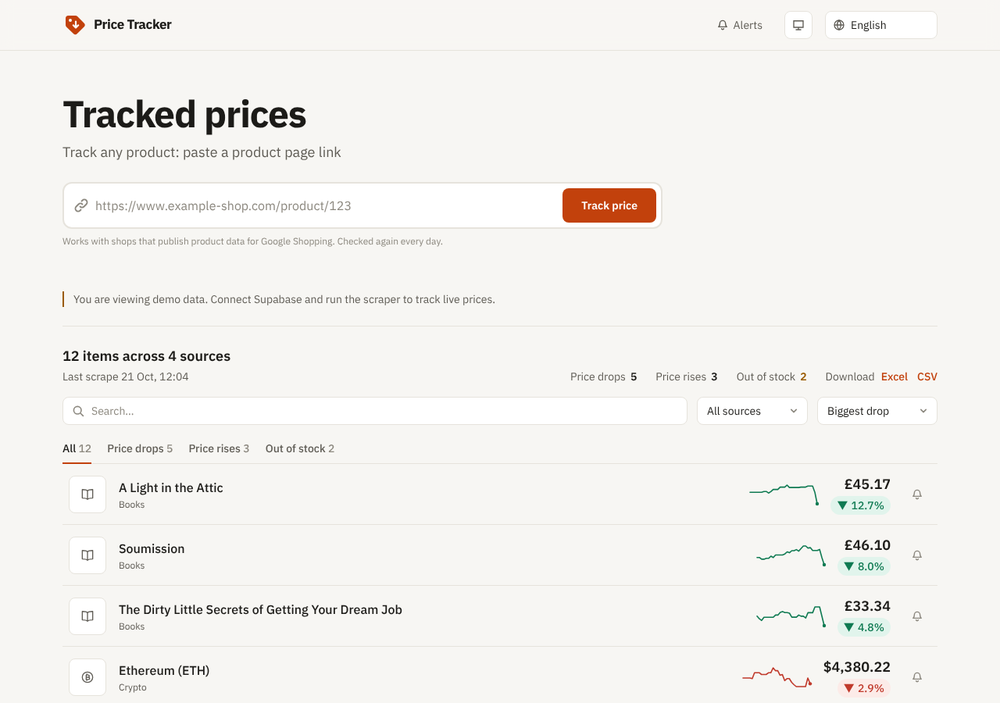
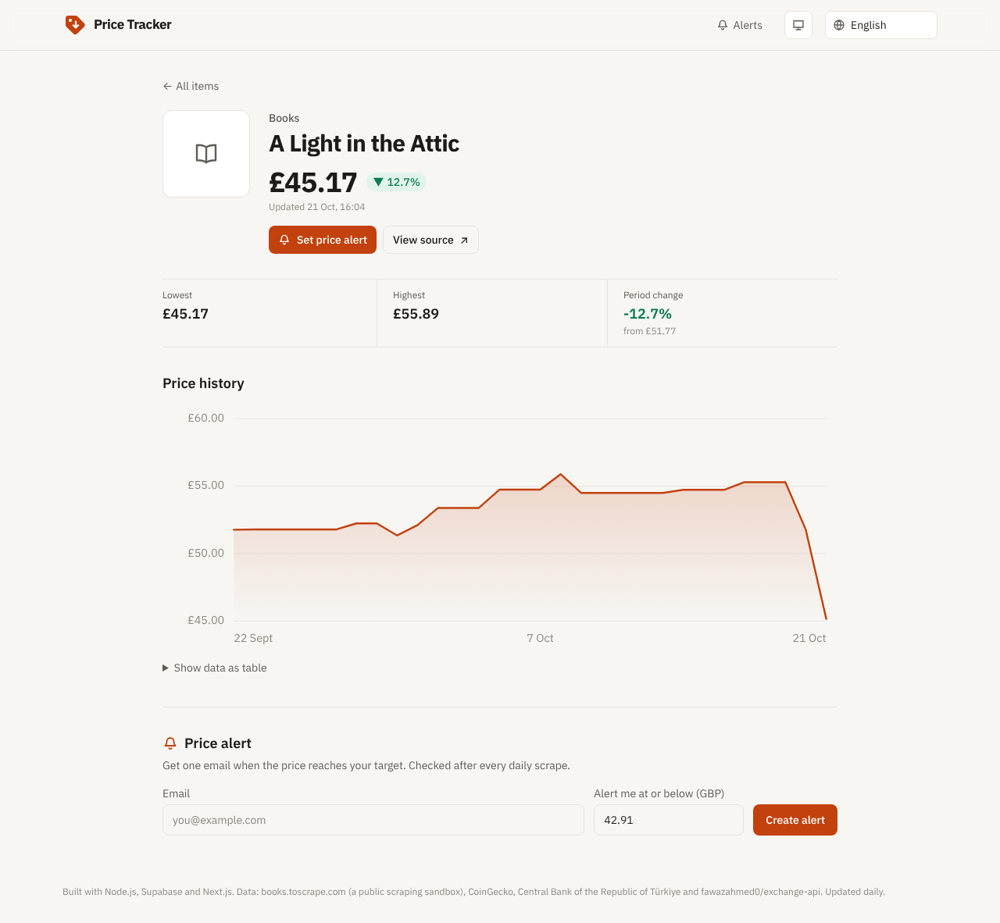
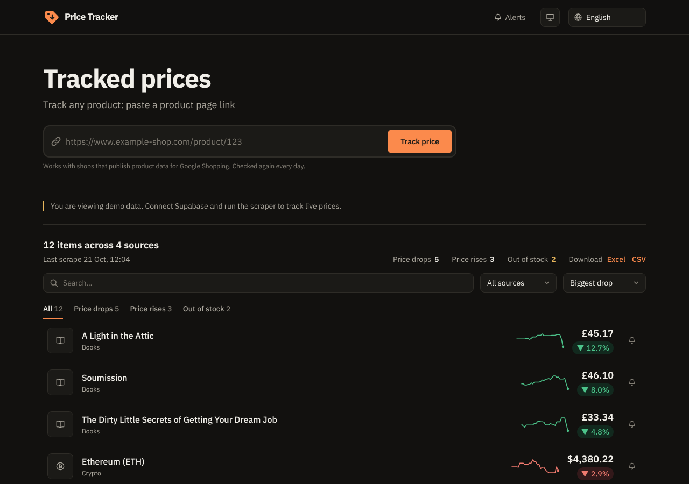

# Price Tracker

**Live demo:** https://price-tracker-shop.vercel.app

A Node.js scraper collects prices from four sources on a schedule (an e-commerce catalogue, crypto, exchange rates and gold) and stores every run in Supabase (Postgres). A Next.js dashboard shows current prices, the change since the last run and stock status.





<details><summary>Dark mode</summary>



</details>

## Structure

| Folder | What it does |
| --- | --- |
| `scraper/` | Node.js 20+ collector. One adapter per source (`src/adapters/`): HTML crawling with pagination (books.toscrape.com), JSON APIs (CoinGecko, gold) and XML (Central Bank of Türkiye rates). Polite fetching with retries; one failing source never blocks the others. Saves to Supabase, or to local JSON when no credentials are set. |
| `supabase/migrations/` | Tables `products`, `price_history`, `alerts`, the `product_latest` view and row level security. |
| `web/` | Next.js dashboard: search, filters and sorting, per-product price history chart, Excel and CSV export, light and dark themes. Shows demo data until Supabase is connected. |

## Run it

```bash
# 1. Database: paste supabase/migrations/0001_init.sql into the Supabase SQL editor
# 2. Scraper
cd scraper && npm install
SUPABASE_URL=... SUPABASE_SERVICE_ROLE_KEY=... npm run scrape -- all 3   # or a single source: coingecko, tcmb, gold, books-toscrape
npm test
# 3. Dashboard
cd ../web && npm install
NEXT_PUBLIC_SUPABASE_URL=... NEXT_PUBLIC_SUPABASE_ANON_KEY=... npm run dev
npm test   # runs the shared shop fixtures in scraper/test/fixtures/shops against the web extractor
```

## Daily schedule

`.github/workflows/scrape.yml` runs the scraper every day at 06:00 UTC and can be started by hand from the Actions tab. It needs one repository secret, `SUPABASE_SERVICE_ROLE_KEY`, and these repository variables (Settings → Secrets and variables → Actions → **Variables**):

| Variable | Example | Used for |
| --- | --- | --- |
| `SUPABASE_URL` | `https://<project-ref>.supabase.co` | The database the scraper and the Pending links job write to (required) |
| `SITE_URL` | `https://your-site.vercel.app` | Links in alert emails and the Telegram digest; without it they point to the shop page |
| `ALERT_FROM` | `Price Tracker <alerts@your-domain>` | Sender of alert emails, a Resend-verified address; defaults to Resend's test sender |
| `SCRAPER_USER_AGENT` | `PriceTrackerBot/0.1 (+https://your-site)` | Optional; the bot name shops see, defaults to `PriceTrackerBot/0.1` |

## Track any product by link

Paste a product page link on the dashboard. The server reads the price through a chain of layers, and the first one that finds a price wins: JSON-LD `Product`/`Offer` (including `AggregateOffer` and the variant that matches the link), schema.org microdata (attribute or visible text), `product:price` meta tags, the state JSON that shops embed for their own JavaScript (`__NEXT_DATA__`, `__INITIAL_STATE__` and similar), and finally small per-shop adapters (Trendyol, Hepsiburada, Amazon, n11). It saves the product, and the daily job re-checks every added link (`source = custom`). A link the shop turns away is kept as pending and retried from GitHub Actions every 15 minutes; when a plain request still fails, the scraper opens the page in a real Chromium (Playwright, `scraper/src/browser-fetch.js`) so prices drawn by scripts can be read too. Links that resolve to private network addresses are refused. Needs `SUPABASE_SERVICE_ROLE_KEY` as a server-side environment variable on Vercel.

Every read of a pasted link, when it is added and on each daily refresh, is logged to the `track_attempts` table with its outcome (`ok`, `http_error`, `no_price`, `timeout`, `network`), the HTTP status and which layer held the price (`json-ld`, `microdata`, `meta`, `embedded-state`, `shop-adapter`, or `browser/...` when the real browser read it). Visitors see a message that matches the reason, in their language.

To measure which shops can be read, run the **Shop probe** workflow from the Actions tab (or `cd scraper && npm run probe`, optionally followed by links). It opens the sample product pages in `scraper/probe-urls.txt` and writes a per-shop table (HTTP code, HTML size, JSON-LD present, price found, layer) to the job summary.

## Blocked shops (optional scraping API)

Reading a pasted link goes through layers, cheapest first:

1. **Plain request** with browser headers, from the server that runs the job.
2. **Markup layers** on the page that came back: JSON-LD, microdata, price meta tags, the state JSON shops embed for their own scripts, and small per-shop adapters (Trendyol, Hepsiburada, Amazon, n11).
3. **Pending links**: when the shop turns the site's server away (401/403/429/503 or a timeout), the link is saved without a price and the **Pending links** workflow retries it from GitHub's servers every 15 minutes for two days.
4. **Real browser**: when the plain request is still turned away or finds no price, the scraper opens the page in a headless Chromium (Playwright, `scraper/src/browser-fetch.js`), lets its scripts run and reads the rendered page. Free, so it always comes before the paid layer.
5. **Scraping API** (optional, off by default): some shops block every datacenter address, real browser included. With a [ScraperAPI](https://www.scraperapi.com/) key, the scraper retries links that both the plain request and the browser were turned away from through the API, which opens the page from a residential address. The markup layers then read the price as usual.

The scraping API costs credits, so it is used only when needed:

| Setting | Where | What it does |
| --- | --- | --- |
| `SCRAPER_API_KEY` | Actions secret | Turns the layer on. Without it nothing changes. |
| `UNBLOCK_HOSTS` | Actions variable, optional | Comma-separated shops read through the API straight away, skipping the plain request and the browser, e.g. `vatanbilgisayar.com,trendyol.com`. Other shops use it only after both the plain request and the browser were blocked. |
| `UNBLOCK_MONTHLY_LIMIT` | Actions variable, optional | Requests per calendar month (default 900). When reached, the layer switches off until the next month. |

Requests are counted from `track_attempts`: reads through the API are logged with the layer `unblock` (failed) or `unblock:<markup>` (price found, e.g. `unblock:json-ld`). A pending link that failed through the API is not sent again for 24 hours. If the monthly count cannot be read, no paid request is made.

## Telegram and Google Sheets

Both are optional and switch on when their repository secrets exist:

- **Telegram**: `TELEGRAM_BOT_TOKEN`, `TELEGRAM_CHAT_ID` (and optional `TELEGRAM_MIN_DROP`, default 2%). After each run the bot posts the day's price drops.
- **Google Sheets**: `GOOGLE_SERVICE_ACCOUNT_JSON`, `GOOGLE_SHEET_ID`. After each run the `Latest` tab is replaced with current prices and a row per item is appended to `History`. Share the sheet with the service account's email as Editor.

## Public API

Read-only JSON, no key needed, CORS open. Interactive docs (Swagger UI): [`/docs`](https://price-tracker-shop.vercel.app/docs), spec at `/api/openapi.json`.

| Endpoint | Returns |
|---|---|
| `GET /api/products?source=&q=&limit=` | Items with latest price and change |
| `GET /api/products/{id}` | One item |
| `GET /api/products/{id}/history?days=90` | Price per scrape, oldest first |

## Price alerts

Visitors leave an email and a target price on any product page. After every scrape the job emails each alert whose target is reached, once, then marks it sent. Emails go through [Resend](https://resend.com): add a `RESEND_API_KEY` repository secret to switch sending on; without it the job only logs which alerts are due. Alerts are write-only for the public (RLS insert policy, no read access).

Guests manage their alerts from the browser that created them: each alert has a secret manage token that only that browser holds.

## Accounts

Email and password sign in with Supabase Auth (`@supabase/ssr`, session cookies refreshed in `src/proxy.ts`). Signed-in users' alerts are saved to their account and readable on any device. Row level security lets each user read, change and delete only their own rows (`supabase/migrations/0005_alert_owners.sql`). Alerts made as a guest move into the account on first sign in. Password reset links open in a separate in-memory session, so they never sign in other tabs. A "Continue with Google" button appears on its own once the Google provider is switched on in Supabase.

## Languages

The interface ships in 24 languages, from English and Turkish to Arabic (right to left), Chinese and Japanese. Pages live under a language segment (`/tr/alerts`); bare links redirect to the saved choice, then the browser's language, then English. Prices, dates and percentages use the reader's number format, and the Excel and CSV downloads come with translated headers (CSV switches to `;` and decimal commas where spreadsheets expect them). Texts are in `web/src/i18n/dictionaries`, one typed file per language.

## Adding a site

Create `scraper/src/adapters/<site>.js` exporting `name` and either `startUrl` + `parseListing(html, pageUrl)` returning `{ products, nextUrl }` (HTML sites) or `fetchAll()` returning products (APIs), then register it in `src/index.js`.

## Roadmap

- [x] Scraper with pagination and retries, unit-tested parser
- [x] Supabase schema with price history
- [x] Dashboard with price change and stock status
- [x] Price history chart per product (hover tooltip, table view)
- [x] Excel (.xlsx) and CSV export (`/api/export?format=xlsx|csv`, spreadsheet-safe)
- [x] Search, filters (drops, rises, out of stock) and sorting
- [x] Light and dark themes, mobile layout
- [x] Multiple sources: crypto (CoinGecko), exchange rates (TCMB XML), gold
- [x] Public JSON API with OpenAPI spec and Swagger UI
- [x] Track any product by pasting its link (JSON-LD, microdata, meta, embedded state JSON and shop adapters)
- [x] Google Sheets sync
- [x] Telegram price-drop digest
- [x] Price-drop email alerts (sign up on the product page, sent after each scrape via Resend)
- [x] Daily schedule (GitHub Actions cron)
